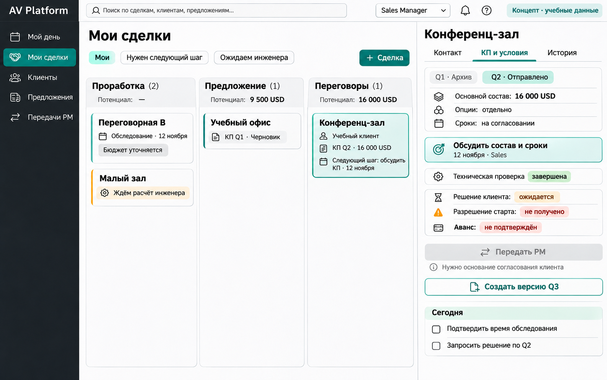
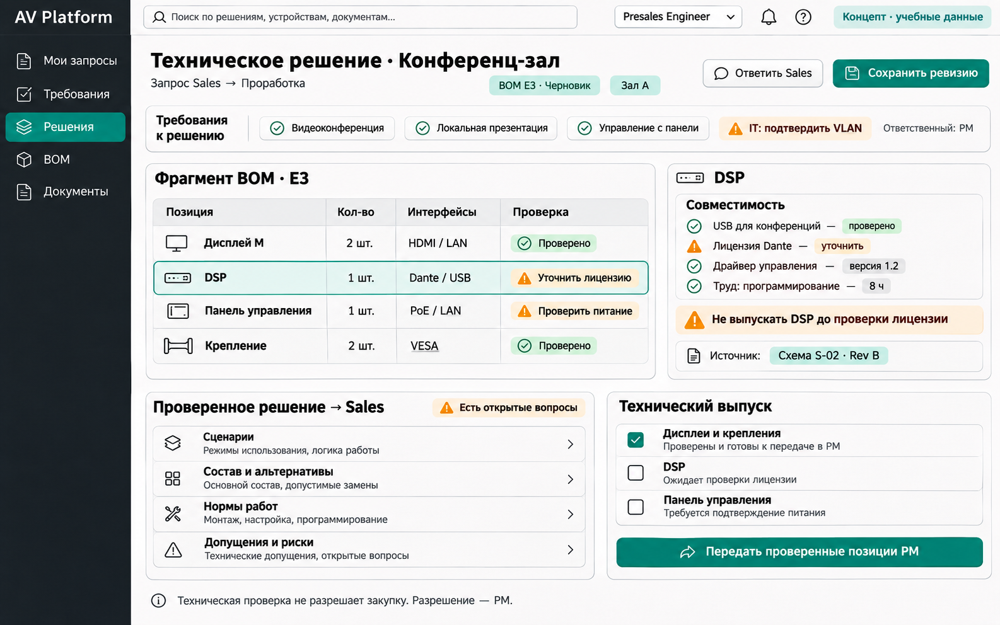
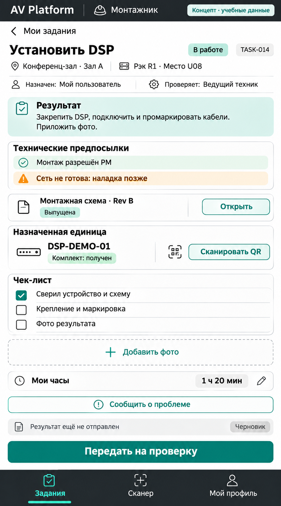
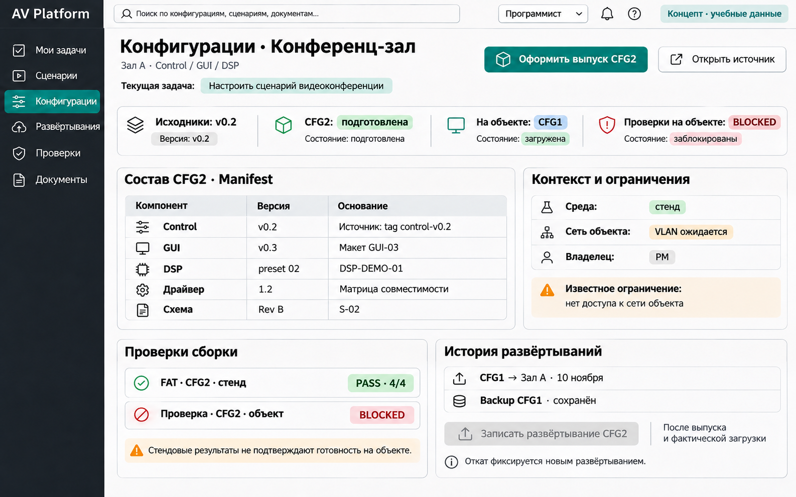
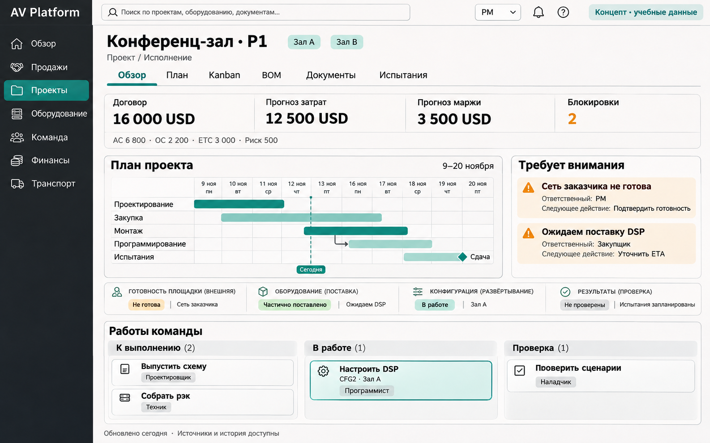
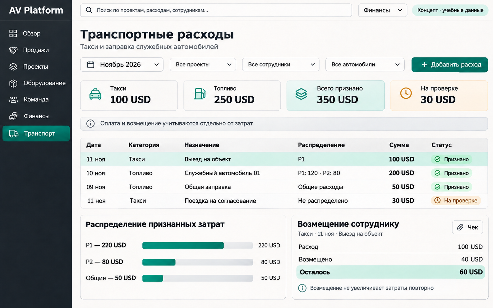

# AV Integration Business Platform

Спецификации собственного веб-продукта для AV-интегратора: от обращения клиента и предложения до закупки, проектирования, монтажа, программирования, испытаний, передачи и контроля экономики. Цель — профессиональный продукт для рынка AV-интеграторов; первый пользователь — собственная AV-компания, выход к другим компаниям следует за внутренним результатом. Финальное название продукта пока не выбрано.

Начните с [MVP-SPEC.md](MVP-SPEC.md) — предварительной спецификации V1 версии 0.6 от 12 ноября 2026 года: отдельные рабочие места сотрудников, project timeline, Kanban, окно расходов на такси и заправку служебных автомобилей, условия допуска к пилоту и учёт доказательств. Там же рыночная цель, четыре решения, принимаемые заранее (ARC-01–ARC-04), и техническая основа: Frappe и ERPNext для данных и бизнес-логики, TypeScript/JS (Vue 3 и frappe-ui) для интерфейсов. Основное окно продукта — Desk Frappe ([ADR-004](.progressive/decisions/ADR-004-desk-as-product-shell.md)).

**Состояние на 15 ноября 2026 года:** технический барьер TP Gate пройден на синтетических данных, в Desk работают первые экраны Sales, PM и руководителя. Это прототип ограниченного среза, а не реализация V1; подробности — в разделе [«Состояние работ»](#состояние-работ).

## Как может выглядеть продукт

Концептуальные макеты будущего интерфейса, созданные с помощью ImageGen по спецификации. Дизайн предварительный, все проекты и суммы учебные; изображения не являются скриншотами работающего прототипа. Фактические экраны прототипа строятся по композиции D-Tools Cloud без их фирменного вида ([research/12](research/12-home-and-navigation.md)) и описаны в [prototype/README.md](prototype/README.md).

У каждой роли своё рабочее место. Макеты показывают задачи разных этапов, поэтому состояние одного учебного проекта на них может различаться.

[Sales Manager](#sales-manager) · [Presales Engineer](#presales-engineer) · [Монтажник](#монтажник) · [Программист](#программист) · [PM](#руководитель-проекта) · [Финансы](#финансовый-ответственный)

### Sales Manager

Свои сделки и следующий шаг, запросы инженеру, версии КП, решение клиента и передача PM. Согласование предложения, разрешение старта и аванс показаны отдельно.

### Presales Engineer

Требования и сценарии, рабочая ревизия BOM, совместимость, лицензии, нормы труда и открытые вопросы. Проверенные позиции передаются PM; техническая проверка сама по себе не разрешает закупку.

### Монтажник

Мобильное задание: место и назначенная единица, актуальная выпущенная схема, комплект, чек-лист, фото, замечания и свои часы. Результат передаётся на проверку ведущему технику; цены и экономика проекта здесь не нужны.

  

### Программист

Сценарии и состав конфигурации Control/GUI/DSP, версии исходников, выпуск, история фактических развёртываний и backup. Готовность кода, загрузка на объект и результаты проверок показаны раздельно; стендовый PASS не заменяет проверку на объекте.

### Руководитель проекта

План с параллельными работами и зависимостями, Kanban команды, блокировки с ответственными и прогноз экономики. Поставка, развёртывание и проверка показаны отдельными состояниями.

### Финансовый ответственный

Такси и топливо, распределение между проектами и общими расходами, проверка оснований и возмещение сотруднику. Признанные затраты и выплаты учитываются отдельно.

Основания и полные промпты сохранены в [описании макетов PM и финансов](docs/visuals/PROMPTS.md) и [описании ролевых рабочих мест](docs/visuals/ROLE-PROMPTS.md). Макеты иллюстрируют требования и не фиксируют окончательное визуальное решение.

## Карта спецификаций

| Документ | Содержание |
|---|---|
| [Спецификация V1](MVP-SPEC.md) | Границы продукта, роли и права, техническая основа и стек, модель данных, правила операций, экономика, сценарии S01–S28 и открытые решения Q1–Q11 |
| [Инструкция для ИИ-агентов](AGENTS.md) | Профиль Progressive Context Kit и правила проекта: где что лежит, правила, которые действуют всегда, команды |
| [Память проекта](.progressive/project/) | Brief, Architecture, [Roadmap](.progressive/project/ROADMAP.md) (фазы и отложенные задачи), текущая фаза и NEXT_SESSION по модели [Progressive Context Kit](https://github.com/Elguajo/Progressive-Context-Kit) |
| [Решения (ADR)](.progressive/decisions/) | ADR-001 основа Frappe + TypeScript, ADR-002 ARC-01–ARC-04, ADR-003 внешний код и лицензии, ADR-004 Desk как основное окно, ADR-005 шлюз моделей ИИ и MCP |
| [Постановка технического прототипа](PROTOTYPE-BRIEF.md) | Проверка выбранной основы Frappe и ERPNext, эксперименты P0–P8, условия TP Gate, дополнительные проверки представлений PV1 и транспортных расходов TV1 |
| [Состояние и запуск прототипа](prototype/README.md) | Фактические результаты каждого шага со статусами, версии, команды запуска, проверки и восстановление |
| [Внешний код](THIRD_PARTY_NOTICES.md) | Происхождение и лицензии заимствованного кода |
| [Исследование: обзор](research/README.md) | Цель продукта, основания выводов, ограничения исследования и приоритеты |
| [Процесс и модель продукта](research/01-workflow-and-product.md) | Параллельные направления работ, сущности, состояния оборудования, готовность, качество и прогноз стоимости |
| [Референсные продукты](research/02-reference-products.md) | Механизмы D-Tools SI и Jetbuilt, полезные для собственного продукта, дополнительные ориентиры и обзор смежных отраслей |
| [Основа и пилот](research/03-platform-and-pilot.md) | Сравнение технических основ, границы стандартного и AV-слоя, источники фактов и критерии пилота |
| [Источники](research/04-sources.md) | Происхождение требований, ссылки на официальные материалы и границы доказательств |
| [Механизмы и решения](research/05-mechanisms-and-decisions.md) | Детальный разбор версий, выпуска, резервов, обратных операций, времени и прав |
| [Проверка реального проекта](research/06-real-project-validation.md) | Нужные материалы, метод разбора, проверки F1–F6 и форма фиксации свидетельств |
| [Разбор ClickUp и YouGile](research/07-work-management-reference.md) | Доска работ, «Мои задачи», timeline и whiteboard; этапы доработки доски BRD-1–BRD-7 |
| [Интервью с пресейл-инженерами](research/08-presales-interview-guide.md) | План интервью и [анкета](research/08-presales-survey-tally.md) о подборе оборудования; интервью ещё не проводились |
| [Рабочие места ролей](research/09-role-workplaces.md) | Руководитель, пресейл, финансы, программист и монтажник: разбор референсов и предложения |
| [Боты и автоматизации](research/10-bots-and-automations.md) | Отложенные BOT-01, BOT-02, AUT-01: бот расходов, бот группы, внешние автоматизации |
| [База знаний команды](research/11-knowledge-base.md) | Отложенная KB-01 «AV Wikipedia»: разделы, хранение, шаги |
| [Главная и навигация](research/12-home-and-navigation.md) | Главная, портфель и страница проекта по композиции D-Tools Cloud (основа UI-03) |
| [Исходный AV workflow](AV-WORKFLOW.md) | Раннее описание инженерного процесса; сохранено как исходный материал |

## Как читать требования

Актуальные границы V1 и происхождение требований находятся в [разделах 1–2 спецификации](MVP-SPEC.md#1-цель-статус-и-доказательства). Исследование и исходный workflow объясняют происхождение предложений; ранние формулировки не отменяют последующие уточнения V1.

Пользователь подтвердил собственную разработку для своей компании, сопровождение этапов с отдельными учётными записями по ролям, timeline/Kanban и отдельное окно транспортных расходов. Детальные правила с обозначением H остаются аналитическими предложениями. Учебный сценарий T1 и финансовые примеры синтетические; полевая проверка компании пока отсутствует.

## Состояние работ

Исходники AV-приложения — в `apps/av_platform/`, окружение — в `prototype/`, локальные проверки правил — в `tests/`. Фактические версии: Frappe 16.55.1, ERPNext 16.53.0, MariaDB 11.8.3, Redis 7.4.6. Каждая строка ниже подтверждена записью в [prototype/README.md](prototype/README.md) со статусами по отдельным проверкам.

| Шаг | Что сделано | Дата |
|---|---|---|
| TP-01–TP-04 | **TP Gate пройден на синтетике:** среда и повторяемость, правила, повтор и атомарность принятия передачи, полномочия (0 утечек), браузер, восстановление из резервной копии | 12–14.11 |
| UI-01, UI-02 | Рабочее место Sales «Мои предложения»; экраны AV перенесены в Desk, отдельный сайт `/av` убран | 12–14.11 |
| PM-01, PM-02, BRD-1 | Доска работ проекта, «Мои задачи», действия на карточке доски | 14.11 |
| DIR-01, UI-03 | «Главная» руководителя и PM, реестр «Все проекты», карточка проекта | 14–15.11 |
| PRJ-01 | Проект создаётся только при принятии передачи Sales → PM, во всех каналах | 15.11 |
| ADM-01 | Роли AV Administrator и AV Moderator | 15.11 |

Последний прогон (ADM-01, 15.11.2026): Frappe-тесты 125/125, access-check — 0 утечек. Не запускались: Ruff, проверка формы User в браузере под модератором, тёмная тема.

Чего ещё нет: timeline (PV1), окно транспортных расходов (TV1), whiteboard, модули закупки, склада, монтажа, программирования, испытаний и финансов (P2–P8), ИИ-ассистент (ADR-005 — только Specified). Прохождение TP Gate не доказывает P2–P8, полевую пригодность и готовность V1. В [разделе 1 спецификации](MVP-SPEC.md#1-цель-статус-и-доказательства) и в [постановке прототипа](PROTOTYPE-BRIEF.md) статус пока описан на 5 ноября; актуальные результаты — в prototype/README.md.

Запуск локально (Windows, Docker Desktop, PowerShell 7) — [инструкция](prototype/README.md#запуск).

## Следующий шаг

Фаза 00 Technical Proof ещё открыта в [Roadmap](.progressive/project/ROADMAP.md). Следующий шаг выбирает пользователь: полировка Desk (русский язык, скрытие лишних модулей ERPNext), BRD-2 «журнал переходов этапа» или фаза 01 — [разбор одного реального проекта](research/06-real-project-validation.md). После этого — ограниченный пилот; до реальных операций пройти PG-01–PG-08. Все этапы, условия перехода и метрики находятся в [разделе 15 спецификации](MVP-SPEC.md#15-критерии-готовности-и-способ-оценки).

Отложенные задачи — демо-стенд на офисном сервере (DEP-01), боты (BOT-01, BOT-02), автоматизации (AUT-01) и база знаний (KB-01) — записаны в [Roadmap](.progressive/project/ROADMAP.md#отложенные-задачи) и начинаются только по решению пользователя.

Продуктовые сценарии приёмки собраны в [разделе 17](MVP-SPEC.md#17-проверяемые-сценарии-приёмки-продукта); решения компании — в [разделе 18](MVP-SPEC.md#18-открытые-решения-и-следующий-шаг). [Реестр E3](research/04-sources.md#10-учёт-предоставленного-аудита-11-ноября-2026) различает принятые, уже учтённые и отложенные выводы аудита.

Пароли, runtime-файлы и резервные копии создаются локально в `.runtime/` и исключены из Git. В опубликованном прототипе используются только синтетические примеры.
