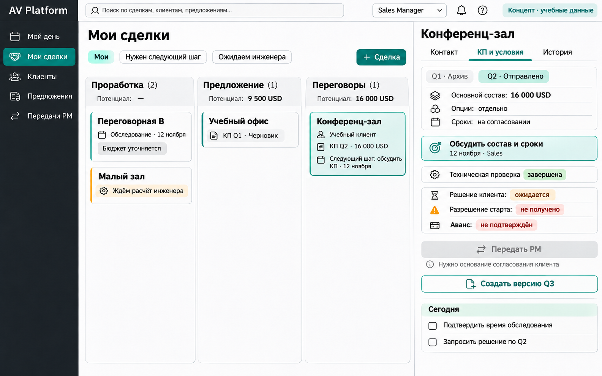
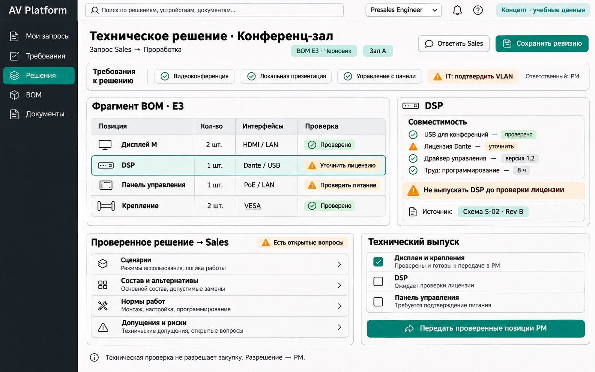
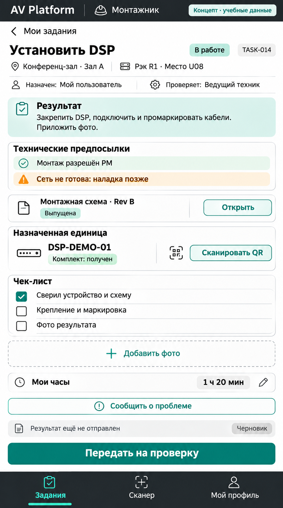
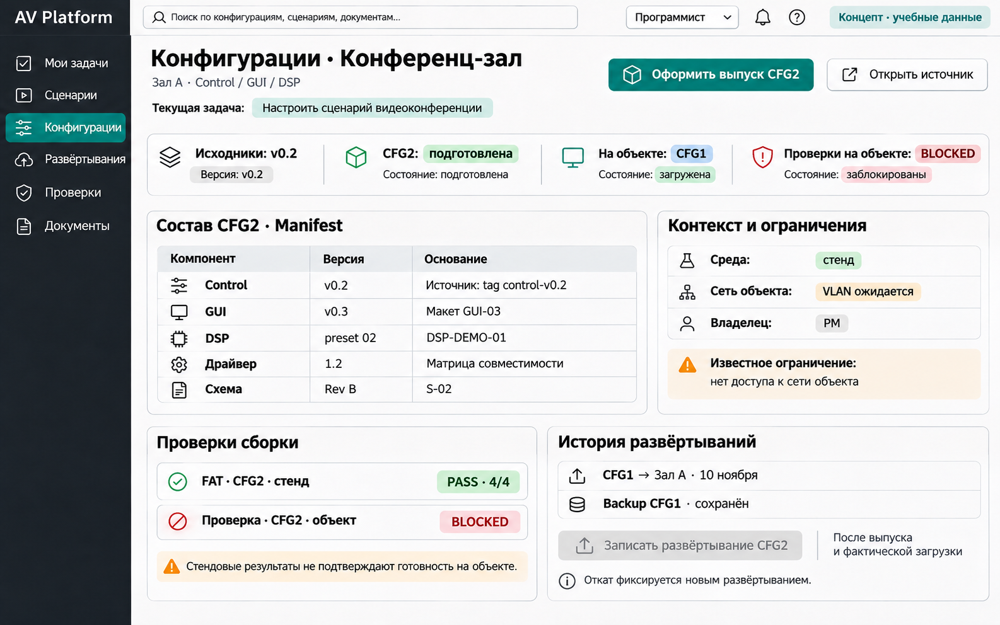
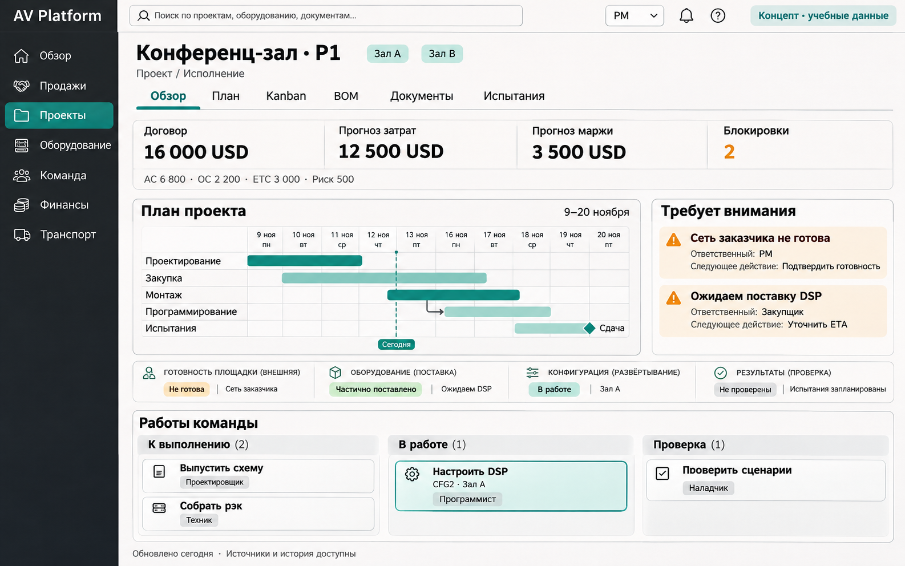
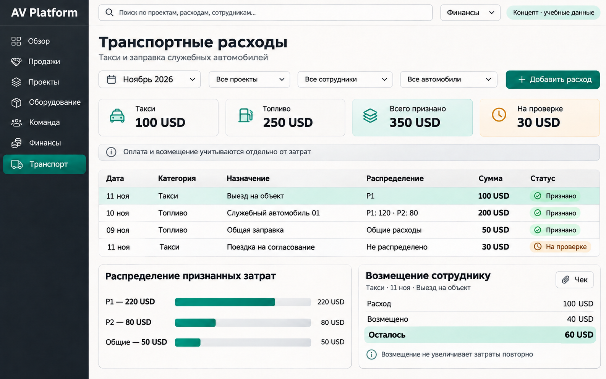

# AV Integration Business Platform

Спецификации собственного веб-продукта для AV-интегратора: от обращения клиента и предложения до закупки, проектирования, монтажа, программирования, испытаний, передачи и контроля экономики. Первый пользователь — собственная AV-компания; дальнейшая продажа другим компаниям рассматривается позднее. Финальное название продукта пока не выбрано.

Комплект собран 11 ноября 2026 года. Начните с [MVP-SPEC.md](MVP-SPEC.md): это актуальная предварительная спецификация V1, включая отдельные рабочие места сотрудников, project timeline, Kanban и окно расходов на такси и заправку служебных автомобилей.

## Как может выглядеть продукт

Концептуальные макеты будущего интерфейса, созданные с помощью ImageGen по текущей спецификации. Дизайн предварительный, все проекты и суммы учебные; изображения не являются скриншотами работающего прототипа.

У каждой роли своё рабочее место. Макеты показывают задачи разных этапов, поэтому состояние одного учебного проекта на них может различаться.

[Sales Manager](#sales-manager) · [Presales Engineer](#presales-engineer) · [Монтажник](#монтажник) · [Программист](#программист) · [PM](#руководитель-проекта) · [Финансы](#финансовый-ответственный)

### Sales Manager

Свои сделки и следующий шаг, запросы инженеру, версии КП, решение клиента и передача PM. Согласование предложения, разрешение старта и аванс показаны отдельно.

### Presales Engineer

Требования и сценарии, рабочая ревизия BOM, совместимость, лицензии, нормы труда и открытые вопросы. Проверенные позиции передаются PM; техническая проверка сама по себе не разрешает закупку.

### Монтажник

Мобильное задание: место и назначенная единица, актуальная выпущенная схема, комплект, чек-лист, фото, замечания и свои часы. Результат передаётся на проверку ведущему технику; цены и экономика проекта здесь не нужны.

  

### Программист

Сценарии и состав конфигурации Control/GUI/DSP, версии исходников, выпуск, история фактических развёртываний и backup. Готовность кода, загрузка на объект и результаты проверок показаны раздельно; стендовый PASS не заменяет проверку на объекте.

### Руководитель проекта

План с параллельными работами и зависимостями, Kanban команды, блокировки с ответственными и прогноз экономики. Поставка, развёртывание и проверка показаны отдельными состояниями.

### Финансовый ответственный

Такси и топливо, распределение между проектами и общими расходами, проверка оснований и возмещение сотруднику. Признанные затраты и выплаты учитываются отдельно.

Основания и полные промпты сохранены в [описании макетов PM и финансов](docs/visuals/PROMPTS.md) и [описании ролевых рабочих мест](docs/visuals/ROLE-PROMPTS.md). Макеты иллюстрируют требования и не фиксируют окончательное визуальное решение.

## Карта спецификаций

| Документ | Содержание |
|---|---|
| [Спецификация V1](MVP-SPEC.md) | Границы продукта, роли и права, модель данных, правила операций, экономика, сценарии S01–S28 и открытые решения Q1–Q11 |
| [Постановка технического прототипа](PROTOTYPE-BRIEF.md) | Проверка кандидата ERPNext/Frappe, эксперименты P0–P8, дополнительные проверки представлений PV1 и транспортных расходов TV1 |
| [Состояние и запуск прототипа](prototype/README.md) | Подготовленный срез Sales → PM, команды запуска, локальные проверки, ограничения и восстановление |
| [Исследование: обзор](research/README.md) | Цель продукта, основания выводов, ограничения исследования и приоритеты |
| [Процесс и модель продукта](research/01-workflow-and-product.md) | Параллельные направления работ, сущности, состояния оборудования, готовность, качество и прогноз стоимости |
| [Референсные продукты](research/02-reference-products.md) | Механизмы D-Tools SI и Jetbuilt, полезные для собственного продукта, и дополнительные ориентиры |
| [Основа и пилот](research/03-platform-and-pilot.md) | Сравнение технических основ, границы стандартного и AV-слоя, источники фактов и критерии пилота |
| [Источники](research/04-sources.md) | Происхождение требований, ссылки на официальные материалы и границы доказательств |
| [Механизмы и решения](research/05-mechanisms-and-decisions.md) | Детальный разбор версий, выпуска, резервов, обратных операций, времени и прав |
| [Проверка реального проекта](research/06-real-project-validation.md) | Нужные материалы, метод разбора, проверки F1–F6 и форма фиксации свидетельств |
| [Исходный AV workflow](AV-WORKFLOW.md) | Раннее описание инженерного процесса; сохранено как исходный материал |

## Как читать требования и состояние работ

Актуальные границы V1 и происхождение требований находятся в [разделах 1–2 спецификации](MVP-SPEC.md#1-цель-статус-и-доказательства). Исследование и исходный workflow объясняют происхождение предложений; ранние формулировки не отменяют последующие уточнения V1.

Пользователь подтвердил собственную разработку для своей компании, сопровождение этапов с отдельными учётными записями по ролям, timeline/Kanban и отдельное окно транспортных расходов. Детальные правила с обозначением H остаются аналитическими предложениями. Учебный сценарий T1 и финансовые примеры синтетические; полевая проверка компании пока отсутствует.

ERPNext/Frappe остаётся кандидатом. В репозитории сохранены подготовленные исходники технического среза Sales → PM в `apps/av_platform/`, окружение в `prototype/` и локальные проверки в `tests/`. Это ограниченный прототип, а не реализация всей V1. По последнему сохранённому отчёту от 5 ноября локальные проверки пройдены; запуск ERPNext, интеграционные и браузерные проверки, восстановление и пригодность платформы ещё не подтверждены. [Подробные статусы](prototype/README.md#состояние-на-5-ноября-2026).

Timeline/Kanban и окно транспортных расходов описаны в требованиях; PV1 и TV1 ещё не выполнены. Новых результатов запуска при сохранении этого комплекта не заявляется.

## Следующая проверка

Следуйте [постановке прототипа](PROTOTYPE-BRIEF.md) и [инструкции запуска](prototype/README.md), затем примените [план разбора одного реального проекта](research/06-real-project-validation.md). Продуктовые сценарии приёмки собраны в [разделе 17](MVP-SPEC.md#17-проверяемые-сценарии-приёмки-продукта); решения, для которых нужны данные компании, — в [разделе 18](MVP-SPEC.md#18-открытые-решения-и-следующий-шаг).

Пароли, runtime-файлы и резервные копии создаются локально в `.runtime/` и исключены из Git. В опубликованном прототипе используются только синтетические примеры.
